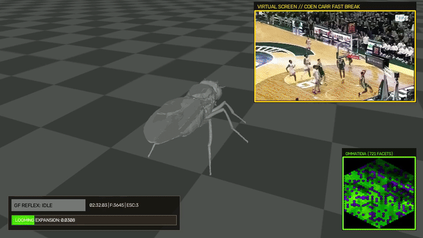

# 🪰 Drosophila Embodied 3D Compound-Eye Vision & Looming Escape Simulation

A biologically grounded 3D embodied simulation pipeline that models *Drosophila melanogaster* in FlyGym's MuJoCo physics arena reacting to basketball broadcast footage (Coen Carr fast break highlights).

---

## 🔬 Scientific & Computational Architecture

```
Broadcast Video (coen_carr.mp4)
       │
       ├──────────────────────────────────────────────┐
       ▼                                              ▼
┌──────────────────────────────────────┐  ┌──────────────────────────────────────┐
│  FlyGym Retina (~721 Ommatidia)      │  │  Virtual Screen Inset (Top-Right)   │
│  - Pale / Yellow spectral types      │  │  - Broadcast video playback          │
│  - Green & UV photoreceptor channels │  └──────────────────────────────────────┘
└──────────────────┬───────────────────┘
                   │ Ommatidia Readout (721, 2)
                   ▼
┌──────────────────────────────────────┐
│  Lobula Plate & Giant Fiber Circuit  │
│  - Temporal derivative ΔI(t)         │
│  - Central field expansion rate      │
└──────────────────┬───────────────────┘
                   │ Giant Fiber Spike
                   ▼
┌────────────────────────────────────────────────────────┐
│  Embodied NeuroMechFly 3D Physics (MuJoCo)            │
│  - 3rd-person over-the-shoulder arena camera           │
│  - 42 active leg joint position servos                 │
│  - Stereotyped jump reaction:                          │
│    FREEZE (crouch) -> JUMP (kick) -> FLIGHT -> RECOVER │
└──────────────────────────┬─────────────────────────────┘
                           │
                           ▼
┌────────────────────────────────────────────────────────┐
│  Composited Scientific Viewport (960×540)              │
│  - Main: 3D fly body in MuJoCo arena                   │
│  - Top-Right: Virtual broadcast screen inset           │
│  - Bottom-Right: 721-facet ommatidia readout inset     │
│  - Bottom-Left: Telemetry HUD, looming bar & GF badge  │
└──────────────────────────┬─────────────────────────────┘
                           │
                           ▼
                   H.264 (yuv420p) MP4
```

---

## 🚀 Quickstart

### Prerequisites
- Python 3.12+ (or 3.11+)
- Virtual environment support

### One-Command Runner
Execute the automated bash runner script:
```bash
./run.sh
```

### Manual Execution

```bash
source venv/bin/activate
python simulate_vision.py --start-sec 140 --count 600
```

---

## ⚙️ Command-Line Options

| Flag | Short | Default | Description |
|------|-------|---------|-------------|
| `--input` | `-i` | `coen_carr.mp4` | Path to source broadcast video |
| `--output` | `-o` | `output/fly_vs_carr.mp4` | Path for generated MP4 video |
| `--start-sec` | | `140.0` | Start timestamp in seconds (02:20 = Carr on the fast break) |
| `--start` | `-s` | `None` | Start frame index (overrides `--start-sec` if provided) |
| `--count` | `-n` | `600` | Number of sequential frames to process |
| `--duration-sec` | | `None` | Duration in seconds (overrides `--count` if provided) |

Examples:
```bash
# Run full 600 frames from 02:20
./run.sh --start-sec 140 --count 600

# Run 30 seconds starting at 02:20
./run.sh --start-sec 140 --duration-sec 30
```

---

## 📊 Pipeline Components

### 1. Embodied NeuroMechFly 3D Physics (`Embodied3DFlySim`)
- Instantiates FlyGym's `NeuroMechFly` model in `FlatGroundWorld` with active leg joints (`JointPreset.LEGS_ACTIVE_ONLY`) and articulated wing hinge joints (`l_wing_yaw`, `l_wing_pitch`, `r_wing_yaw`, `r_wing_pitch`).
- A third-person over-the-shoulder camera tracks the fly from behind-left, overlooking the arena with full clearance for ballistic escape jumps.
- When the Giant Fiber fires, active kinematic and joint angle transitions govern the embodied jump mechanics:
  - **FREEZE**: Lowers center of mass (COM) / root Z elevation, crouching and slightly tucking legs.
  - **JUMP**: Explosive ballistic extension impulse driving the mesothoracic and metathoracic legs (`trochanterfemur` and `tibia` joints) backwards and thrusting the fly root Z-position off the arena floor.
  - **FLIGHT**: Wings spread outward and upward with high-frequency flutter oscillation (`wing_pitch` / `wing_yaw`), airborne root elevation, and aerodynamic leg flexion.
  - **RECOVERY**: Smooth cosine-interpolated joint and COM reset back to neutral stance over 12 frames.

### 2. Biological Retinal Mapping (`HexRetina`)
- Maps frames to the **721 ommatidia** per eye using FlyGym's `Retina`.
- Reconstructs biological hexagonal mosaic using JIT `hex_pxls_to_human_readable` with green (pale) and UV/violet (yellow) photoreceptors.

### 3. Lobula Plate & Giant Fiber Circuit (`LoomingDetector`)
- Calculates the temporal derivative $\Delta I(t) = I(t) - I(t - \Delta t)$.
- **Broadcast Cut Filter**: Filters out hard broadcast camera switches by measuring whole-frame absolute deltas. If a large global fraction (>50%) of ommatidia jump simultaneously or mean global delta exceeds threshold, it is classified as a broadcast cut and discarded from the looming accumulator, preventing false escape triggers.
- Monitors expansion $\frac{d\theta}{dt}$ in the central visual field ($35\%$ central ommatidia) with adaptive thresholding and refractory cooldown to trigger primarily when Coen Carr accelerates toward the camera or elevates toward the rim on the fast break.

### 4. High-Tech Inset Compositor (`EmbodiedCompositor`)
- **Main Stage**: The 3D fly body reacting in the MuJoCo arena.
- **Top-Right Inset**: Virtual Screen playing the Coen Carr broadcast footage with a cyan tech bezel.
- **Bottom-Right Inset**: Hexagonal ommatidia readout showing the fly's compound-eye perception.
- **Bottom-Left HUD**: Giant Fiber State Indicator Badge, real-time Looming Expansion meter, broadcast timecode, and escape counter.

### 5. Web & VS Code H.264 Transcoding (`transcode_to_h264`)
- Encodes output directly to standard **H.264** (`libx264` / `avc1`) with **YUV420p** pixel formatting and `+faststart` metadata headers.
- Plays natively inside VS Code's built-in media viewer, web browsers, and QuickTime.
